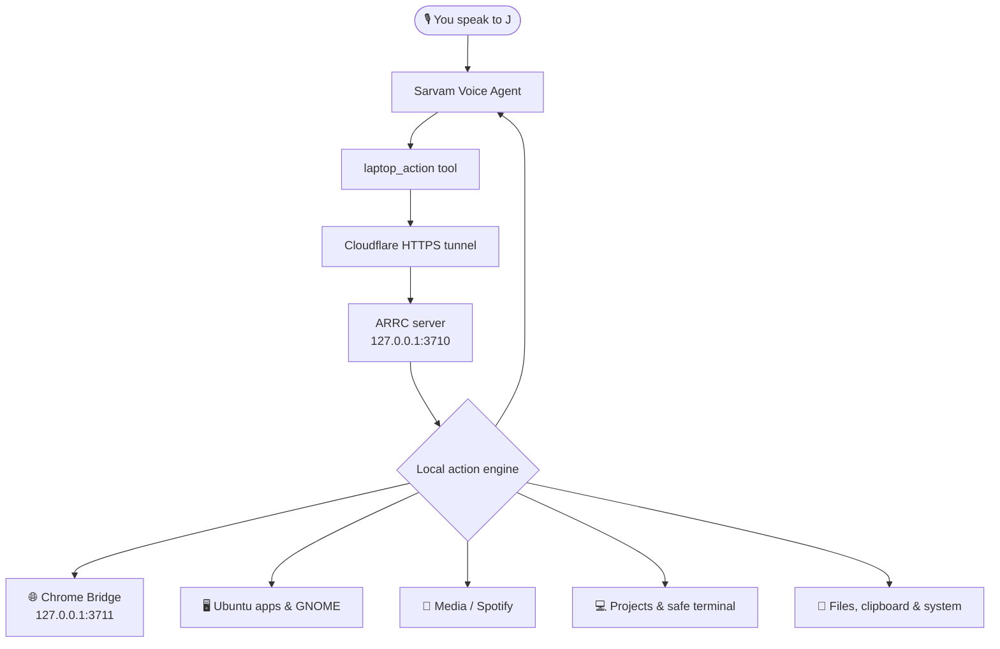

<div align="center">


<p>
  <a href="#quick-start"></a>
  <a href="#architecture"></a>
  <a href="#security"></a>
  <a href="#browser-control"></a>
</p>

<p>
  <b>Speak naturally. J operates your Ubuntu laptop through a secure local action engine.</b><br />
  Chrome tabs • apps • media • projects • safe terminal commands • files • clipboard • system status
</p>

</div>

---

## ✨ What is J?

**J** is a voice-controlled Ubuntu laptop assistant built for the Sarvam Hackathon. Sarvam Voice Agent handles conversation and speech; the **ARRC** server on your laptop performs narrowly scoped, authenticated actions and reports a concise result back to J.

> **Sarvam = ears, voice, and reasoning** &nbsp;·&nbsp; **ARRC = hands** &nbsp;·&nbsp; **Ubuntu + Chrome = environment**

```text
“J, Chrome ka GitHub wala tab kholo.”
“J, ARRC VS Code me kholo.”
“J, terminal me git status chala.”
“J, Cold Water chala.”
```

## 🚀 Highlights

| Capability | What J can do |
| :-- | :-- |
| 🌐 **Chrome control** | List, switch, open, search, read, scroll, find, copy and screenshot real Chrome tabs. |
| 🖥️ **Ubuntu apps** | Discover and open installed apps such as Spotify, VS Code, Files, Terminal and Chrome. |
| 🎵 **Media** | Play/pause/skip, inspect currently playing media, and control volume using Linux-native tools. |
| 💻 **Developer flow** | Open projects in VS Code, inspect Git status, run approved project scripts and safe terminal commands. |
| 📁 **Files** | Find recent PDFs, open Downloads, reveal files, and search sensible project/document roots. |
| ⚙️ **System** | Battery, RAM, CPU, disk, network, brightness, audio and screenshots. |
| 🛡️ **Safety first** | Bearer auth, owner/session checks, local-only bridges, confirmation gates and a terminal allowlist. |

## 🏗️ Architecture



## 🎯 Things you can say

<details open>
<summary><b>🌐 Chrome</b></summary>

- “J, what Chrome tabs are open?”
- “J, switch to the ChatGPT tab.”
- “J, search Google for Ceph GSoC.”
- “J, find pricing on this page.”
- “J, scroll to the bottom.”
</details>

<details>
<summary><b>🖥️ Apps and projects</b></summary>

- “J, open Spotify.”
- “J, open my ARRC project in VS Code.”
- “J, open terminal in ARRC.”
- “J, show ARRC git status.”
- “J, show my open windows.”
</details>

<details>
<summary><b>🎵 System and media</b></summary>

- “J, what’s playing?”
- “J, pause the music.”
- “J, battery kitni hai?”
- “J, volume 40 percent.”
- “J, take a screenshot.”
</details>

## 🔒 Security

J is intentionally **not** an unrestricted remote shell.

- The public tunnel reaches only the authenticated ARRC action endpoint.
- Dashboard, Chrome bridge and GNOME bridge stay on the local machine.
- Browser extension communicates only with `localhost` and pairs with a local token.
- Sensitive actions—such as closing tabs/windows, starting project scripts, lock/power operations and webpage clicks—require an explicit, short-lived confirmation.
- Terminal typing permits an approved read-only command list only; secrets, destructive commands and shell injection are blocked.
- `.env`, bearer tokens, browser credentials and private keys are never exposed in action output.

## 🧭 Project map

```text
ARRC-Build-Your-Own-J/
├── README.md                         # You are here
├── Start-J.sh                        # Ubuntu launcher
├── UBUNTU-UPGRADE.md                 # Full setup, actions and limitations
├── J-agent/
│   ├── 1-instructions-prompt.txt     # Paste into Sarvam agent instructions
│   └── 2-tool-description.txt        # Paste into laptop_action description
├── arrc/
│   ├── server.js                     # Authenticated action endpoint + dashboard
│   ├── engine.js                     # Structured action router
│   ├── safety.js                     # Allowlist, redaction and confirmations
│   ├── desktop.js                    # Ubuntu apps, media, clipboard, system
│   ├── browser-bridge.js             # Local Chrome extension bridge
│   ├── workspace.js                  # Projects, files and safe dev workflows
│   ├── start.js                      # Server + Cloudflare tunnel runner
│   └── test/                         # Browser, safety and server tests
├── browser-extension/                # J Browser Bridge for existing Chrome tabs
└── gnome-extension/                  # GNOME 46 window + approved terminal bridge
```

## ⚡ Quick start

```bash
git clone https://github.com/Anshdeep-Singh-9/Sarvam_Hackathon.git
cd Sarvam_Hackathon
./Start-J.sh
```

The first run creates local settings and prints a temporary Cloudflare URL. Put that URL in Sarvam’s single `laptop_action` tool, add the bearer secret, then commit a Sarvam agent version.

For Chrome tab control, load the included **J Browser Bridge** extension and pair it locally:

```bash
node arrc/bridge-pair.js
```

> Detailed setup, supported actions, dependencies and Wayland notes: **[UBUNTU-UPGRADE.md](UBUNTU-UPGRADE.md)**

## 🧪 Verify the build

```bash
cd arrc
npm test
node doctor.js
```

## 🧩 Browser control

Unlike a temporary automation browser, J controls tabs in your practical Chrome session through a minimal, paired local extension. It can match tabs by title, domain, URL or keywords and returns a clarification when a match is ambiguous.

The bridge is deliberately bound to `127.0.0.1`; it is never exposed through Cloudflare.

## 🐧 Ubuntu + Wayland notes

GNOME Wayland deliberately restricts generic global keyboard and mouse automation. J therefore prefers semantic browser/app actions and uses the included local GNOME extension for supported window operations and approved terminal typing. See the upgrade guide for the one-time extension installation and log-out/sign-in step.

---

<div align="center">
  <sub>Built with ☕, JavaScript, Ubuntu GNOME, Chrome and Sarvam Voice Agent.</sub>
</div>
